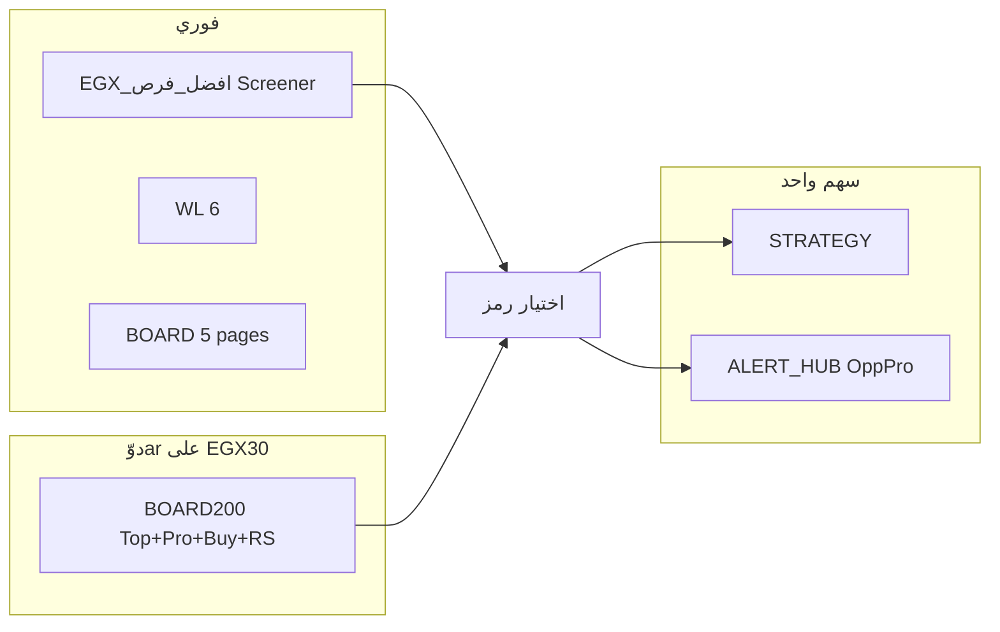

# EGX — أفضل فرص (200 سهم)

جدول ترتيب فرص السوق على **200 سهم سائل** في EGX.  
Pine على الشارت يمسح **40 رمز في الصفحة** — لذلك اللوحة **5 صفحات**.

| الملف | ماذا يفعل |
|--------|-----------|
| **`pine/EGX_افضل_فرص_BOARD200.pine`** | **Top N من 200/294** — 8★ مثبتة + 32 دوّar/bar (~**10** شموع لـ 294) |
| `pine/EGX_افضل_فرص_STRATEGY.pine` | باك‌تست · Pro/Buy/Pass · خروج Action=0 |
| `pine/EGX_OPP_META.pine` | Opp × Meta · `EGXOppMeta_Pro` |
| `pine/EGX_OPP_UNIFIED.pine` | Opp × Vol Rank · `EGXOppUni_Pro` |
| `pine/EGX_افضل_فرص_BOARD.pine` | 40 سهم/صفحة · 5 صفحات يدوي (فوري لكل صفحة) |
| `pine/EGX_افضل_فرص_WATCHLIST.pine` | **6 رموز** مرتّبة فرصة↓ · فوري · `EGXOppWL_*` |
| `pine/EGX_افضل_فرص.pine` | درجة الفرصة + **Stock Screener** (فوري لكل السوق) |
| `docs/EGX_WATCHLIST_200.txt` | قائمة استيراد 200 رمز `EGX:XXXX` |

**ليست توصية استثمارية.**

تفاصيل الحدود والجلسة: [`docs/EGX_MICROSTRUCTURE.md`](EGX_MICROSTRUCTURE.md).

---

## 1. جدول 200 كامل — مسح دوّar (الملف المفتوح)

1. شارت **`EGX:EGX30`** · إطار **D**.
2. أضف `EGX_افضل_فرص_BOARD200.pine`.
3. **الكون = 200** (افتراضي).
4. انتظر اكتمال المسح — **8★ مثبتة** تُحدَّث كل bar · الباقي دوّar (`مسح · XX%` · `~N شمعة`).
5. الجدول يعرض **أفضل Top N** من الـ 200 مرتّب **فرصة↓** (ليس فقط الدفعة الحالية).
6. للنتيجة **فورية**: Stock Screener + `EGXOpp_Score` (نفس المنطق).

| مدخل | معنى |
|------|------|
| الكون 200 / 294 | 200 سائل · 294 = 200 + باقي القائمة |
| إخفاء تحت حد الفرصة | يخفي الصفوف الضعيفة |
| شراء فقط | `EGXOpp_Buy` فقط |
| Pro فقط | Buy + فرصة ≥ حد Pro + إعداد قوي |
| جدول «شراء» أسفل | Buy (أو «حار») مرتّب فرصة↓ · R/R · RVOL |
| حد Pro | عمود «Pro» في الجدول الرئيسي |
| إطار أسرع | تلميح في التذييل (D / 15 / …) — المنطق على **D** |
| ★01–★08 | **مثبتة** — تُمسح كل bar (COMI · SWDY · …) |

**قراءة الشاشة:** جدول **يمين** = Top N · **أسفل يسار** = Pro · **أسفل يمين** = شراء · ★ = Leader · `مسح · 100%` = الكون محدّث.

---

## 2. جدول 200 — 5 صفحات (فوري لكل صفحة)

1. افتح شارت **`EGX:EGX30`** إطار **D**.
2. Pine Editor → الصق `EGX_افضل_فرص_BOARD.pine` → Save → Add to chart.
3. اترك «الشارت هو EGX30» **ON** (لحساب RS بدون استهلاك استدعاء).
4. من المدخلات اختر الصفحة:

| صفحة | المحتوى |
|------|---------|
| 1 كبار 1–40 | أكبر الأسهم (COMI …) |
| 2 | 41–80 |
| 3 | 81–120 |
| 4 | 121–160 |
| 5 | 161–200 |

5. الجدول مرتّب **فرصة من الأعلى**. الصف ★ = أفضل مرشح في الصفحة.
6. اختياري: «إخفاء الأضعف» أو «شراء فقط».

---

## 3. محفظة 6 — فوري

1. شارت **`EGX:EGX30`** · **D**.
2. أضف `EGX_افضل_فرص_WATCHLIST.pine`.
3. عدّل الرموز الستة في المدخلات — الجدول يُرتّب **فرصة↓** تلقائياً.
4. تنبيهات: `EGXOppWL_LeaderBuy` · `EGXOppWL_MktStress` (ضغط EGX30).

---

## 4. باك‌تست (سهم واحد)

1. شارت **`EGX:XXXX`** · إطار **D**.
2. Strategy → `EGX_افضل_فرص_STRATEGY.pine`.
3. **دخول:** Pro (افتراضي) · Buy · Pass — نفس بوابات `EGX_افضل_فرص.pine`.
4. **خروج:** وقف دعم · T1 جزئي · متحرك (مثل BEST).
5. راقب: `EGXOppST_Pro` · `EGXOppST_Score`.

---

## 5. تنبيهات موحّدة

على **نفس السهم** أضف `EGX_ALERT_HUB.pine`:

- `EGXAlHub_OppPro = 1` — Pro يومي (مسار أفضل فرص).
- `EGXAlHub_OppBuy = 1` — شراء Opp.
- `EGXAlHub_Any = 1` — Hub + Opp + Tools + Spike.

على **EGX30** أضف `BOARD200` وتنبيهات: Leader Buy · Pro في الكون · مسح 100% · ★ Leader تغيّر.

---

## 6. مسح الـ 200 دفعة واحدة (Screener)

1. احفظ `EGX_افضل_فرص.pine`.
2. Watchlist → Import → `docs/EGX_WATCHLIST_200.txt`
   أو Stock Screener → بورصة **EGX**.
3. أضف عمود `EGXOpp_Score` ورتّب **تنازلي**.
4. فلتر: `EGXOpp_Pro = 1` أو `EGXOpp_Buy = 1`.

---

## 7. قراءة الأعمدة

| عمود | معنى | حد عملي |
|------|------|---------|
| `EGXOpp_Score` | درجة الفرصة /100 | ≥ **68** قوي |
| `EGXOpp_Rank` | رتبة فنية | ≥ **65** قياسي |
| `EGXOpp_Buy` | إشارة شراء | `= 1` |
| `EGXOpp_Pro` | إعداد احترافي | `= 1` |
| `EGXOpp_Setup` | شروط /11 | ≥ **7** |
| `EGXOpp_RR` | عائد/مخاطرة | ≥ **1.5** |
| `EGXOpp_RVOL` | حجم نسبي | ≥ **1.0** |
| `EGXOpp_RS` | فارق ROC20 vs EGX30 | `> 0` قائد |
| `EGXOpp_Action` | 3 شراء · 2 جاهز · 1 انتظار · 0 تجنب | — |
| `EGXOpp_DayPct` | تغير اليوم % | قرب **halt** (±10 نشط / ±5 SME) أو **LULD** |
| `EGXOpp_Limit` | منع قرب الحد | `= 0` للشراء |
| `EGX_افضل_فرص_BOARD200.pine` | لوحة 200/294 دوّارة (**40/bar** على EGX30) | `EGXOppB200_RegimeOk` · `EGXOppB200_MktHalt100` · `BuyCount` |
| `EGXOppWL_*` | محفظة 6 | `LeaderScore` · `MktStress` |
| `EGXOppST_*` | Strategy | `Pro` · `Score` |
| `EGXAlHub_OppPro` | Hub على السهم | Pro يومي + لا ضغط EGX30 |

الدرجة = فني 45% + إعداد 35% + R/R 20%.

```text
EGXOpp = 1
EGXOpp_Score ≥ 68
EGXOpp_Pro = 1
```

---

## خارطة تحسين (ماذا يُضاف لاحقاً)

### قيد TradingView (مهم)

| القيد | التأثير | البديل العملي |
|--------|---------|----------------|
| ~**40** `request.security` / bar | لا مسح 200 فوري على شارت واحد | BOARD200 دوّar · **Screener** · BOARD 5 صفحات |
| لا استدعاء مؤشر من مؤشر | Hub ≠ BOARD200 تلقائياً | نفس المنطق + plots (`EGXOppB200_*` / `EGXAlHub_Opp*`) |
| Strategy = **رمز الشارت** فقط | لا باك‌تست 200 سهم دفعة واحدة | ST على كل سهم · أو SDK/automation خارج TV |

### أولوية عالية (قيمة / جهد)

1. **توحيد المنطق** — `f_opp` في BOARD200 = `EGX_افضل_فرص.pine` (اختراق 2-bar · Rank · Pass · EMA200 · distRisk 65).
2. **Screener = مصدر الحقيقة** — تصفية `EGXOpp_Pro=1` + `EGXOpp_RS>0` + `EGXOpp_Limit=0`؛ BOARD200 للعرض والتنبيهات.
3. **تصدير Top10** — صف في الجدول: رموز مفصولة بفاصلة (نسخ للمراقبة / webhook).
4. **تنبيه مركّب** — «Pro + RVOL≥1.2 + RS>0» · «Spike + Buy» (BOARD200 فيه `spikeCnt` جزئياً).
5. **STRATEGY** — خروج `EGXOpp_Action=0` · مقارنة Pro vs Buy vs Pass في تقرير الاستراتيجية.

### أولوية متوسطة

6. **قطاع** — عمود/فلتر (بنوك · عقار · …) يحتاج خريطة رمز→قطاع ثابتة (~200 `switch`).
7. **تقاطع فوليوم** — `EGX_VOLUME` / `EGXVScr_Rank` ≥ X مع `EGXOpp_Pro` (Hub أو screener مركّب).
8. **محفظة 12–20** — توسيع WATCHLIST مع batches (16–20 security).
9. **15د / 60د** — مسح **★ المثبتة** على intraday؛ المنطق يبقى D للقرار.
10. **Preset سكربت** — مزامنة `عدّاء 200` / `كبار 294` مع `EGX_قرar_PRESETS` و `WATCHLIST_200`.

### خارج Pine (إن احتجت «سوق كامل فوري»)

- **Cursor SDK / Automation** — حلقة: Screener API أو قائمة 200 → ترتيب → Telegram.
- **جدول Google / Notion** — webhook من تنبيهات `Leader تغيّر` · `ProCount≥3`.

### ما ليس مفيداً غالباً

- محاولة 294 `security` في bar واحد (سيفشل أو يُقطع).
- نسخة ثانية ضخمة من «الأخير» داخل BOARD200 (حدود سطور + استدعاءات).

### ما لديك اليوم (مرجع سريع)



**اقتراح جلسة واحدة:** Screener Pro↓ → افتح Top3 على D → ST + Hub → EGX30 + BOARD200 للتنبيهات.

### فجوات (تاريخي — Pack A)

منطق **`f_opp`** في **BOARD200** و **WATCHLIST** يطابق **`EGX_افضل_فرص.pine`** (أسبوع · /11 · Rank · Pass · Pro). للقرار النهائي على 200 سهم: **Stock Screener** (`EGXOpp_Pro=1`)؛ BOARD200 للعرض والتنبيهات بعد `Ready%`.

### طبقة ثالثة — تكامل باقي المشروع

| الفكرة | الملفات | الفائدة |
|--------|---------|---------|
| **Opp × Meta** | `EGX_META_SCREENER` + `EGXOpp_Pro` | Triple: أخير + Vol + قرar **و** فرصة |
| **Opp × Unified** | `EGX_UNIFIED_SCREENER` · `EGXUni_Pro` | فني Pro + Vol Rank |
| **Opp × قرar** | `EGX_قرar_QxV` · `EGXQV_Agree` | توافق قرar وفوليوم قبل Opp |
| **Opp × Tools** | `EGX_TOOLS_OPP` · `EGX_TOOLS_BOARD200` | 100 أداة lite vs فرصة كاملة |
| **Opp × Sector** | `EGX_SECTOR_BOARD` · `EGXSec_Lead3d` | فرصة داخل **قطاع قائد** |
| **قائمة الرموز** | `scripts/gen_egx_tools_board200.py` | تحديث 200/294 عند تغيّر السوق |

### تنبيهات — ما ينقص

- تنبيهات BOARD200 على **EGX30** → `{{ticker}}` = المؤشر، **ليس** Leader (COMI…).
- **تحسين:** صف **Top10 نسخ** في الجدول · تنبيه على **كل سهم** عبر Screener `EGXOpp_Pro` · webhook يقرأ `LeaderIdx` + جدول رموز خارجي.

### مصفوفة (أثر × جهد)

| | جهد منخفض | جهد متوسط | جهد عالٍ |
|--|-----------|-----------|----------|
| **أثر عالٍ** | Top10 نسخ · تنبيه Spike+Pro · ST خروج Action=0 | توحيد `f_opp` · Opp Meta screener | قطاع 200 · SDK مسح يومي |
| **أثر متوسط** | Preset قرar · stale-cache % | WL 12–20 · 15د لل★ | باك‌تست محفظة دوّارة |
| **أثر منخفض** | المزيد من plots Top11–20 | ثيم جداول | heatmap كامل 200 |

### Pack جاهز للتنفيذ (اختر حرفاً)

| حرف | المحتوى |
|-----|---------|
| **A** | توحيد منطق Opp (BOARD + Hub + WL) — **منفّذ** |
| **B** | Top10 export + تنبيهات مركّبة — **منفّذ** |
| **C** | `EGX_OPP_META` screener (Opp ∧ Vol/Meta) |
| **D** | قطاع (بنوك/عقار/اتصالات…) — **جزئي** (BOARD200 `showSector`) |
| **E** | صيانة قائمة 200 (سكربت + تحقق رموز TV) |

---

## جلسة واحدة (Playbook)

1. **صباحاً — Screener:** `EGXOpp = 1` · `EGXOpp_Pro = 1` · `EGXOpp_RS > 0` · `EGXOpp_Limit = 0` · رتّب `EGXOpp_Score` ↓  
2. **انسخ Top6–8** من صف **Top10** في BOARD200 (أو من Screener) إلى **★01–★08**  
3. **EGX30 + BOARD200** · انتظر `مسح · 100%` (أو `ReadyPct ≥ 88`)  
4. **Watchlist 6–12** (`EGX_افضل_فرص_WATCHLIST`) على نفس الرموز — تحقق Rank/Pro  
5. **كل مرشح:** `EGX_افضل_فرص.pine` + **Hub** `EGXAlHub_OppPro` على الشارت  
6. **باك‌تست:** `EGX_افضل_فرص_STRATEGY` · خروج **Action=0** (مدخل جديد)

### BOARD200 — مدخلات جديدة

| مدخل | وظيفة |
|------|--------|
| ملف (≈ Screener) | حجم/Rank/Pro مثل `EGX_افضل_فرص.pine` |
| كاش عند إغلاق الشمعة | تقليل flicker |
| واجهة مدمجة | رئيسي + Pro فقط |
| عمود قطاع | بنوك/عقار/… |
| Top10 نسخ | صف للّصق في ★ |
| حد Ready% للتنبيه | افتراضي 88 |
| إزاحة دفعة | شارت BOARD200 ثانٍ |

### plots/alerts جديدة

`EGXOppB200_LeaderRank` · `LeaderAction` · `LeaderDist` · `HotProCount` · تنبيه **HotPro** · **Spike+Pro** · **Leader Buy + Regime**

### Pack A–E — حالة التنفيذ

| Pack | الحالة |
|------|--------|
| **A** | `f_opp` في BOARD200 = مرآة Screener (Rank · Pass · Pro · /11) · WL12 · ST · Hub Opp |
| **B** | Top10 نسخ + تنويع قطاع · `LeaderComposite` · HotPro alerts |
| **C** | `pine/EGX_OPP_META.pine` — `EGXOppMeta_Pro` |
| **D** | `f_secTag` · `sectorFlt` · `showSector` · Top10 diversify |
| **E** | `scripts/validate_egx_watchlist.py` · `scripts/regen_board200_symbols.py` |

### Pack F — Opp×Vol + Hub + WL

| بند | الحالة |
|-----|--------|
| **F1** | `EGX_OPP_UNIFIED.pine` — `EGXOppUni_Pro` · `EGXOppUni_Score` |
| **F2** | Hub — `EGXAlHub_OppSpikePro` (Pro + RVOL spike) |
| **F3** | WL — صف نسخ Top N · `EGXOppWL_ProCount` · تنبيه 2+ Pro |
| **F4** | BOARD200 — `EGXOppB200_LeaderSpikePro` |

**Screener مركّب (مقترح):**

```text
EGXOppUni_Pro = 1
EGXOppUni_VolRank ≥ 65
EGXOppMeta_Pro = 1   ← Opp + Meta (Triple اختياري)
```

```bash
python3 scripts/validate_egx_watchlist.py
python3 scripts/regen_board200_symbols.py > docs/generated_board200_batches.pine
```

---

## Desk — طبقة ثانية (بعد BOARD200)

| خطوة | أداة | فلتر |
|------|------|------|
| 1 | Stock Screener | `EGXOpp_Pro = 1` · `EGXOpp_RS > 0` · `EGXOpp_Limit = 0` |
| 2 | **`EGXOppDesk_Pro = 1`** | `EGX_OPP_DESK.pine` (Opp ∩ Mega في ملف واحد) |
| 3 | أو **`EGXOppMeta_Pro = 1`** | `EGX_OPP_META.pine` |
| 4 | أو **`EGXMega_Pro = 1`** | `EGX_MEGA_SCREENER.pine` |
| 4 | Hub على المرشح | `EGXAlHub_Mega = 1` أو `EGXAlHub_OppPro = 1` |
| 5 | BOARD200 | **Pass فقط** / **HotPro فقط** · **Rank** sort · **فلتر قطاع** |

### BOARD200 — آخر إضافات

- **ترتيب Rank** · فلاتر **Pass** · **HotPro**
- تذييل: **Breadth%** · **Heat%** · **σ فرصة** · فلتر قطاع
- plots: `EGXOppB200_PassCount` · تنبيه **5+ Pass** · **Breadth 15%+**
- **Top10** مع **تنويع قطاع** (≤2/قطاع)
